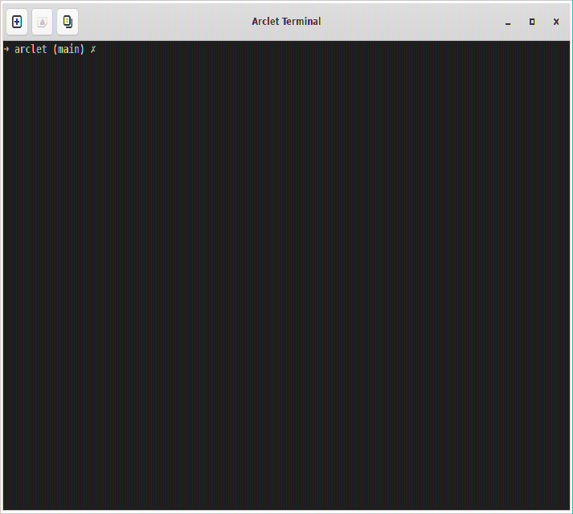
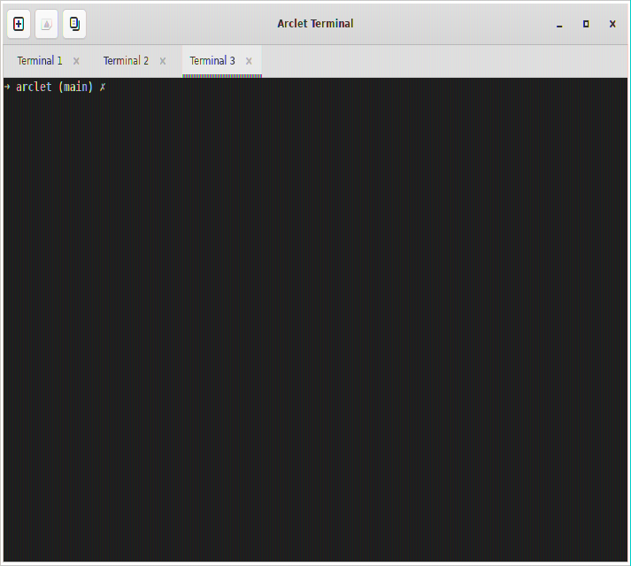
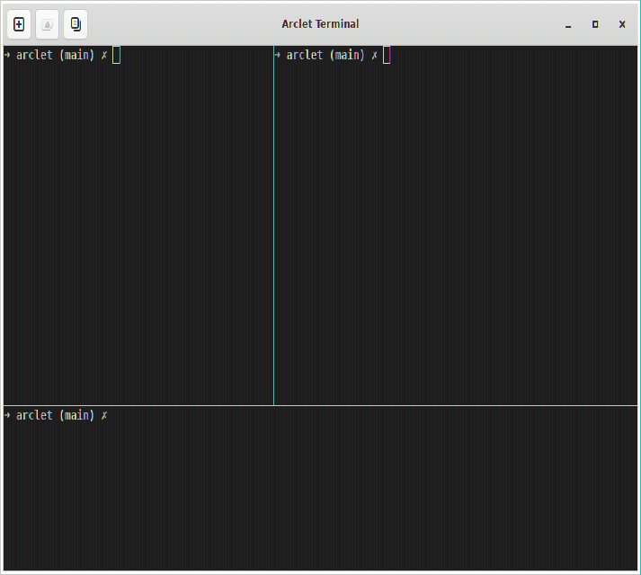
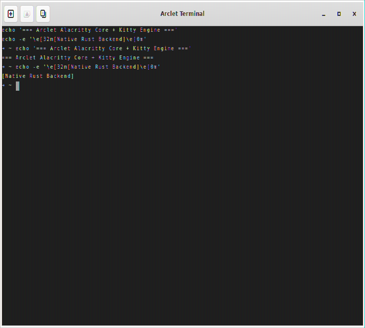

# Arclet Terminal

Arclet Terminal is a Rust GTK4 terminal emulator project building toward a custom, Kitty-class terminal engine with native Linux desktop integration.

The current default build uses VTE as a temporary working scaffold so the app remains usable while the custom backend matures. VTE is not the intended final engine. The long-term direction is a custom GTK4 terminal emulator backed by Ghostty/libghostty-vt or an equivalent modern terminal core, with Arclet-owned PTY, input, rendering, and graphics architecture.

## Requirements

- Rust 1.94+
- GTK4 development libraries
- VTE GTK4 development libraries for the default scaffold backend
- Zig 0.15.2 for the optional Ghostty/libghostty-vt prototype backend

This workspace includes a local Zig install at `.tools/zig` when bootstrapped by Jcode. It is ignored by git.

## Build

Default scaffold backend:

```bash
cargo check
cargo run
```

Optional Ghostty/custom backend prototype:

```bash
PATH="$PWD/.tools/zig:$PATH" cargo check --no-default-features --features ghostty
PATH="$PWD/.tools/zig:$PATH" cargo run --no-default-features --features ghostty
```

The Ghostty path may require network access for native dependency downloads performed by `libghostty-vt-sys`.

## Screenshots

| Single Session (Tokyo Night Theme) | Multi-Tab Management |
| :---: | :---: |
|  |  |

| Split Panes (Horizontal & Vertical) | Native Rust Engine (Alacritty) |
| :---: | :---: |
|  |  |

## Current Status

The application has been refactored into modular subsystems under `src/`:

- **Modular UI (`src/app/`)**: GTK4 `MainWindow` with custom HeaderBar, `TabManager` (GTK4 Notebook multi-tab), and `TerminalPane` (GTK4 Paned recursive horizontal/vertical splits).
- **Pluggable Backends (`src/backend/`)**: Decoupled `TerminalBackend` trait with support for both VTE and native Rust `alacritty_terminal` (0.26).
- **PTY Management (`src/pty/`)**: Thread-safe `PtySession` abstraction using `portable-pty` managing lifecycle, master resize, and background async reader threads.
- **Shortcuts & Input (`src/input/`)**: `ShortcutManager` mapping key combinations (`Ctrl+Shift+T`, `Ctrl+Shift+W`, `Ctrl+Shift+D`, `Ctrl+Shift+E`, etc.) and `KittyKeyboardEncoder`.
- **Graphics Subsystem (`src/graphics/`)**: `KittyGraphicsInterceptor` APC escape extractor, `KittyParser` protocol decoder, and `ImageRegistry` placement cache.
- **Styling (`src/config/`)**: Tokyo Night / Arclet Dark palette (`#1a1b26` background, `#c0caf5` foreground, 16 ANSI colors).

## Product Direction

Arclet should not remain a thin VTE wrapper. VTE exists to preserve a usable baseline while the custom backend path is proven. The target product is a modular terminal emulator with separate PTY, parser/state, input, renderer, and graphics subsystems.

The immediate focus is to validate the custom backend foundation before advanced features:

1. Stabilize the Ghostty/libghostty-vt build path or choose an equivalent terminal core if Ghostty is not viable.
2. Implement correct PTY lifecycle and resize behavior.
3. Replace direct Cairo row drawing with a renderer-independent scene model.
4. Choose a renderer technology that can support styled text, cursor, selection, scrollback, and future grid-positioned images.
5. Design Kitty-compatible graphics support before implementation.

